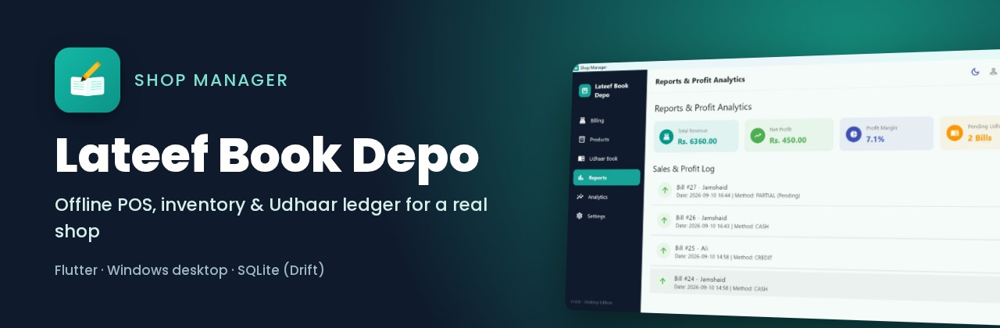
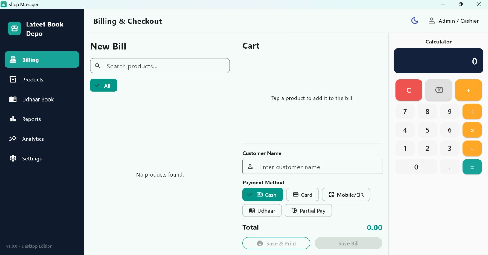
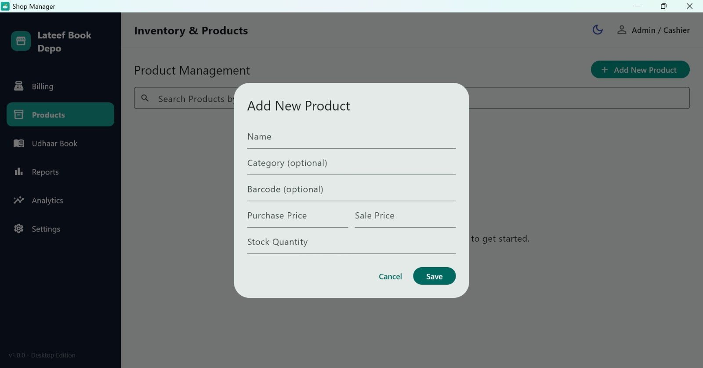
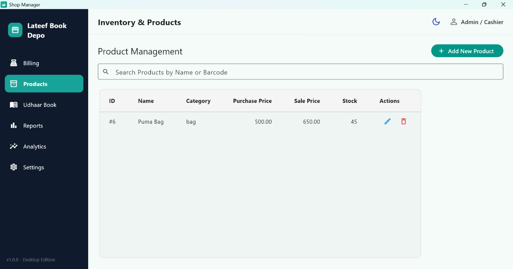
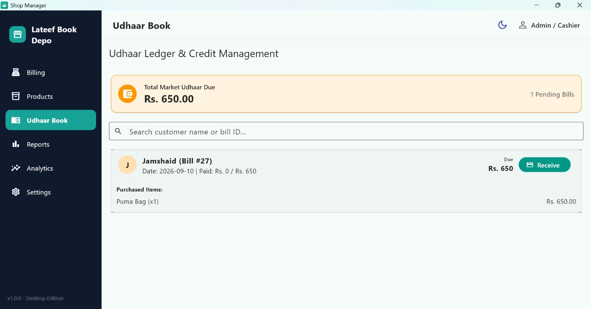
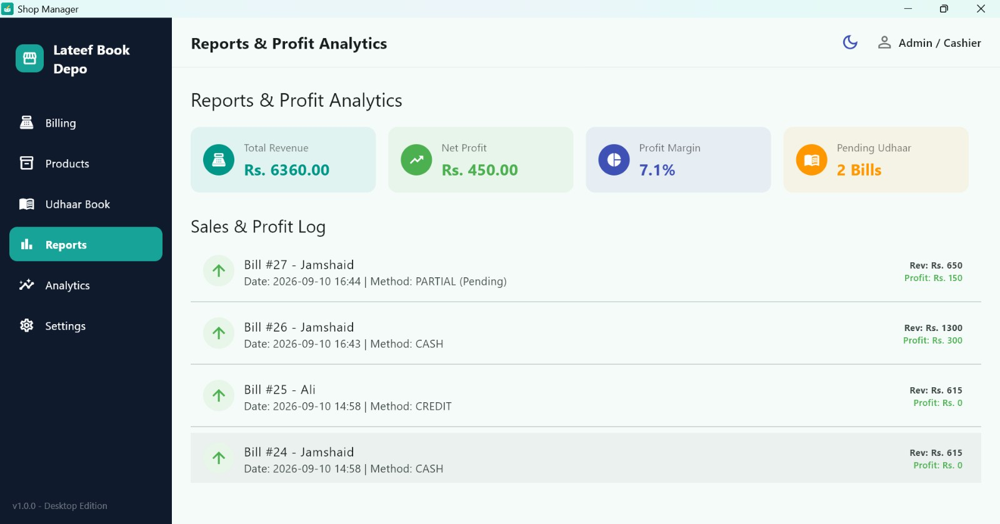
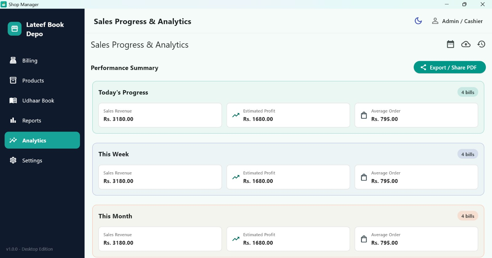
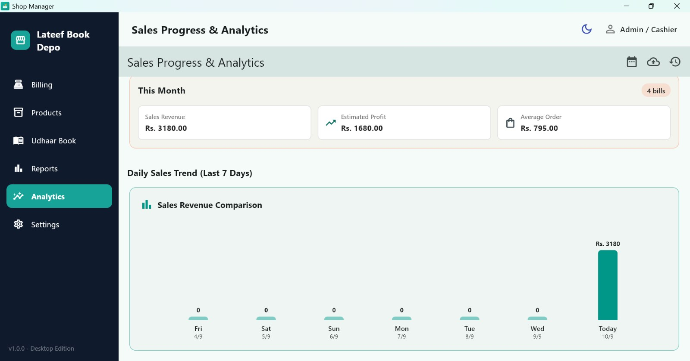

<div align="center">



<p>
<picture></picture>
<picture></picture>
<picture></picture>
</p>

<p>
<picture></picture>
<picture></picture>
<picture></picture>
<picture></picture>
</p>

**An offline-first Point of Sale, inventory and Udhaar (credit) management system built in Flutter for a real stationery shop.**<br>
Designed, developed and delivered end-to-end as my first paid client project.



</div>

---

## 📌 About the project

**Lateef Book Depo** needed a way to move away from handwritten bills and manually tracked customer credit. This app replaces that entirely with a native **Windows desktop application**: no internet dependency, no subscriptions, running locally on the shop owner's own laptop.

I handled everything myself: **requirements gathering, UI design, development, packaging, on-site installation and receipt-printer setup** on the client's laptop.

---

## ✨ Features

| Area | What it does |
|---|---|
| 🧾 **Billing & Checkout** | Searchable product grid, live cart, quantity adjustments, category filters and a built-in calculator |
| 💳 **Payment methods** | Cash, Card, Mobile/QR, **Udhaar** (credit) and **Partial Pay** |
| 📒 **Udhaar Book** | A credit ledger showing total market dues, with partial or full payments received against open bills |
| 📦 **Inventory** | Product catalogue with purchase and sale price, stock quantity, categories and optional barcodes |
| 🖨️ **Receipt printing** | Thermal-printer-ready receipts on an **80 mm roll**, generated as a PDF layout |
| 📊 **Reports** | Total revenue, net profit, profit margin, pending Udhaar and a full sales & profit log |
| 📈 **Analytics** | Today / this week / this month summaries, average order value, a 7-day sales trend chart and PDF export/share |
| 💾 **Backup & restore** | One-click JSON export and import of the whole database for data safety |
| 📴 **Offline-first** | Local SQLite database via Drift, with zero internet dependency |
| 🌗 **Light & dark mode** | Switch theme from the top bar |

---

## 🖼️ Screenshots

### Billing & Checkout


### Inventory & Products


### Add New Product


### Udhaar Book (credit ledger)


### Reports & Profit Analytics


### Sales Progress & Analytics


### Daily Sales Trend


---

## 🛠️ Tech stack

| Technology | Usage |
|---|---|
| **Flutter & Dart** | Windows desktop UI |
| **Drift (SQLite)** | Offline local database |
| **`pdf` & `printing`** | 80 mm thermal receipts and PDF reports |
| **`file_picker` & `path_provider`** | Backup and restore files |
| **`window_manager`** | Desktop window control |
| **Inno Setup** | Windows installer for the client's laptop |

---

## 📁 Project structure

```
lib/
├── main.dart            # App shell, sidebar navigation, theming
├── database/            # Drift tables and generated database code
├── screens/             # Billing, Products, Udhaar, Reports, Analytics, Settings
├── services/            # Receipt printing, backup and restore
├── utils/               # Receipt layout
└── widgets/             # Reusable UI (stat cards)
```

---

## 🚀 Run it locally

```bash
git clone https://github.com/jamshaidkhanniazi5965-ship-it/lateef-book-depo-shop-manager.git
cd lateef-book-depo-shop-manager
flutter pub get
flutter run -d windows
```

> Needs the Flutter SDK with Windows desktop support enabled.

---

## 🧭 My process

1. **Requirements:** sat with the shop owner to understand how billing, stock and customer credit were handled on paper.
2. **Design:** planned a simple sidebar layout that a cashier can use quickly at the counter.
3. **Build:** developed billing, inventory, the Udhaar ledger, reports and analytics in Flutter with a local SQLite database.
4. **Delivery:** packaged it as a Windows installer, installed it on-site and set up the thermal receipt printer.
5. **Support:** added backup and restore so the shop never loses its data.

---

## 💡 Why this project matters to me

I'm a first-year Computer Science student at **PIEAS**. This was the first time a real business trusted me with a real problem, and the first time I got paid for solving it. From requirements gathering to development, on-site installation and printer setup on the client's own laptop, I built and delivered this project entirely on my own.

---

## 👨‍💻 Author

**Jamshaid Khan Niazi**, Niazi Tech

- 🌐 Portfolio: [jamshaidkhanniazi5965-ship-it.github.io](https://jamshaidkhanniazi5965-ship-it.github.io)
- 💼 GitHub: [@jamshaidkhanniazi5965-ship-it](https://github.com/jamshaidkhanniazi5965-ship-it)
